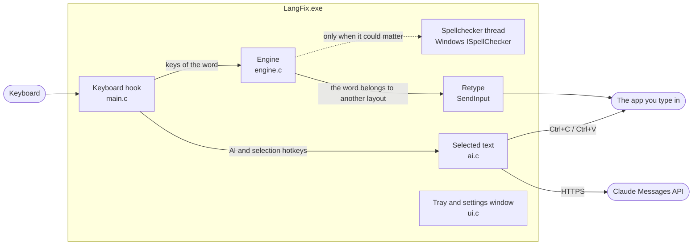

# LangFix

Fixes words typed in the wrong keyboard layout on Windows 10/11, and lets Claude fix,
rewrite or translate the text you select.

Type `יקךךם` in the Hebrew layout when you meant English, press Space, and it becomes
`hello ` and the layout switches to English. LangFix works with any installed layouts and is
tuned for English, Russian and Hebrew.

`LangFix.exe` is one file of about 480 KB. It needs no installer and no runtime.
- It already contains the 30,000 most common words of each language.
- It uses about 4 MB of memory and practically no CPU while you are not typing.
- It decides on most words in a few microseconds.

## Use

Run `LangFix.exe`. The settings window opens and an icon (two arrows) appears in the tray.
Closing the window keeps LangFix running. Click the tray icon or start the exe again to bring
the window back. "Start LangFix automatically when Windows starts" starts it quietly in the
tray.

| Key | What it does |
|---|---|
| **Space** | checks the word you just typed and fixes it if another layout clearly fits (a small hint shows what changed) |
| **Pause** or **both Shift keys** | converts the word you are typing or the last word. Right after an automatic fix it undoes the fix, and that word is left alone from then on |
| **Shift+Pause** | converts the whole selected text, e.g. a sentence typed in the wrong layout |
| **Ctrl+Alt+Enter** | Claude fixes spelling and grammar in the selection, wrong-layout words included. With nothing selected, it works on the line before the cursor |
| **Ctrl+Alt+Space** | the AI menu: fix, improve, shorten, more formal, more friendly, translate to your languages, convert layout, or ask Claude anything |
| **Esc** | cancels while Claude is working. **Ctrl+Z** in the app undoes an AI change |

Every hotkey can be changed or switched off in the settings window.

### Settings window tabs

| Tab | Settings |
|---|---|
| **General** | On/off · start with Windows · Start menu entry · fix hints · also check on Enter · update check · how eager to fix |
| **Hotkeys** | convert/undo keys · selected-text conversion · a shortcut to turn LangFix on and off |
| **Languages** | which installed layouts to switch between, and how each one is recognized |
| **Words** | *My words* (slang, names, terms to always recognize) · *Never change* · chat slang on/off |
| **AI** | Claude API key · model (Opus 5.5, Sonnet 5.5 or Haiku 5.5) · AI hotkeys · test connection |
| **Apps** | apps where automatic fixes are off, such as games and terminals. The hotkeys still work there |

It is deliberately cautious:
- Only Space triggers a fix, and Enter only if you turn that option on.
- Words with digits are never touched, and neither are classic password boxes or LangFix's own window.

## AI writing tools

AI needs a Claude API key from the [Anthropic Console](https://console.anthropic.com/settings/keys).
Paste the key on the **AI** tab. It is stored encrypted for your Windows account with DPAPI, and
the `ANTHROPIC_API_KEY` environment variable also works.

Privacy and data:
- **Only the text you select is sent, and only when you press an AI hotkey.**
- Normal typing never leaves your PC.

How a request works:
- LangFix copies the selection, sends it to `POST /v1/messages`, pastes the reply in place, and puts your clipboard back.
- Its temporary clipboard contents are kept out of clipboard history (Win+V).
- Requests use effort `low`, so short edits come back fast.
- Opus and Sonnet requests opt into server-side refusal fallbacks.

## Performance

Measured on the development PC: Windows 11, a 1.7 GHz laptop CPU, with other programs keeping it
about 85% busy. On an idle PC every time below is shorter.

| | 1.2 | 1.3 |
|---|---|---|
| Checking a word typed in the right layout (the normal case) | 250–660 µs | **12–60 µs** |
| Words that needed the Windows spellchecker: English, Russian, Hebrew | 100%, 100%, 100% | **3%, 2%, 13%** |
| CPU time per mouse movement while you are not typing | ~230,000 cycles | **none** (the mouse hook is off) |
| Memory (private bytes, started in the tray) | 4.4 MB | 4.3 MB |
| CPU while idle | under 0.01% of one core | under 0.01% of one core |
| `LangFix.exe` | 480 KB | 482 KB |

The word timings come from `lftest -type`, which types the sample texts in `corpus/` (1,349 to 1,869
words each) through the engine, word by word, the way the app sees them. The 1.3 engine makes
exactly the same decisions as 1.2 on all of those words and on all test words. Only the work it
skips is different.

Accuracy at the *Balanced* setting, measured with `lftest` on 405 words, each typed in the two
wrong layouts:
- missed or wrong fixes: English 7 of 290 (2.4%), Russian 9 of 264 (3.4%), on a PC without a
  Russian spellchecker, and Hebrew 20 of 256 (7.8%);
- false switches: none of the same 405 words typed correctly, and none of 109 slang words,
  names and typos that must stay as they are.

## How it works

### Overview



LangFix is a plain Win32 program written in C, with no C runtime and no framework. The parts
that run on every keystroke allocate no memory.

| Thread | What it does |
|---|---|
| **Main thread**, high priority | Runs the message loop. Windows calls the low-level keyboard and mouse hooks on this thread, so the word tracking, the engine, retyping, the tray and the settings window all run here, one event at a time, with no locks. |
| **Spellchecker thread**, high priority | Owns the Windows spellchecker (COM, multithreaded apartment). The main thread hands it a batch of words and waits at most 50 ms, so a slow dictionary can never stall typing. |
| **Short-lived workers** | Copying the selection, pasting a result, a Claude request, the daily update check. Each posts its result back to the main thread and exits. |

### What happens to a word

1. **Recording.** The keyboard hook stores each key of the current word as a
   *physical* key: virtual-key code plus Shift and Caps Lock. Storing keys rather than letters
   is the core idea: the same keys can be read as `יקךךם`, `hello` or `руддщ`.
2. **Resetting.** Anything that edits text in a way LangFix cannot follow ends the word:
   arrows, Tab, Enter, shortcuts with Ctrl or Alt, a mouse click, or switching windows. After
   30 seconds without typing, LangFix forgets the word too.
3. **Reading.** At startup, and whenever layouts change, LangFix asks Windows
   (`ToUnicodeEx`) which character each key gives in each installed layout, and keeps a
   256 × 4 table per layout. Layouts that type the same characters, such as US and UK English,
   are merged into one group. On Space, the engine reads the recorded keys through every
   group's table. Each reading is a *candidate*.
4. **Scoring.** Each candidate gets a cost: how unlikely it is as a word of that layout's
   language. See the next section.
5. **Deciding.** LangFix fixes the word only if the current reading costs clearly more than
   another reading. The extra cost it requires grows when:
   - the current reading is a real word,
   - the previous word was confidently in this layout (less than a minute ago),
   - the current reading looks like a typo of a real word. The spellchecker is asked for
     suggestions one edit away.
6. **Fixing.** LangFix sends one `SendInput` batch: Backspaces, the corrected word as
   Unicode characters, and the Space. It also asks the window to switch its layout
   (`WM_INPUTLANGCHANGEREQUEST`). A short hint near the caret shows what changed.
7. **Ambiguous short words.** `to` is also Hebrew `אם`. A short word like that is left alone,
   and then fixed together with the next word once that word gives the language away.
8. **Undo.** Pause (or both Shifts) right after a fix types the original back and adds the
   word to *Never change*.

### How a reading is scored

Costs are in 1/8 of a bit: a cost of 8 means "half as likely". Lower is more natural.

| Evidence | Effect on the cost |
|---|---|
| **Letter model:** `−log2 P(letter │ two letters before it)`, summed over the word including its end | Trained per language on the 30k-word list, weighted by word frequency, plus hand-written everyday text. Witten-Bell smoothing. Stored as one byte per letter triple: 27³ = 19,683 bytes for English. |
| **Vocabulary:** the word is among the 30,000 most frequent | −12 bits for the top 1,000, −8 bits for the top 5,000, −4 bits for the rest. A word from *My words* counts like a top word, and chat slang −7 bits. |
| **Windows spellchecker** (where a dictionary is installed) | Valid: −12 bits for words of 4 letters or more. Hebrew gets only −2 bits, because prefixes make many strings valid, and 2–3 letter words get nothing. Misspelled: +4 bits, and the vocabulary bonus is halved. |
| **Spelling rules** the letter model learns too weakly | Hebrew final letters `ך ם ן ף ץ` in the middle of a word: +6 bits. Hebrew `כ מ נ פ צ` at the end of a word: +3 bits. Russian `ъ ы ь` at the start of a word: +6 bits. |
| **Punctuation** stripped from the edges | Ordinary marks such as `. , ! ? ( ) "`: +5 bits each. Anything else: +10 bits each. |

A target reading must also be acceptable on its own. It must be a known word, or a
dictionary word, or read naturally enough as letters (under 5.75 bits per letter). Two-letter
targets must be on a short list of real two-letter words. When two other layouts fit almost
equally well (less than 2 bits apart), nothing happens.

The bar for switching is 10, 8 or 6 bits for *Careful*, *Balanced* and *Eager*. These values
were tuned with `lftest`'s threshold sweep, on the test words typed in every layout and the 109
words that must never change.

### Why it is fast

- **Most words never reach the spellchecker.** For each reading, the engine first computes the
  best and worst cost any dictionary answer could give it. A word typed in the right layout
  reads as gibberish in every other layout, whatever the dictionary says. When no answer could
  give another reading the upper hand, the engine skips the spellchecker entirely. This changes
  no decision: 1.2 and 1.3 give identical results on every test.
- **Recent answers are cached.** The engine remembers the last 512 spellchecker answers. People
  repeat a few hundred words all day, so a repeated short word costs a table lookup instead of
  a round trip to another thread.
- **The mouse hook runs only when needed.** Windows calls a low-level mouse hook for every
  movement, and the whole system's mouse waits for it. LangFix needs only clicks, and only while
  it is tracking a word, so it installs the mouse hook when you start typing a word. It removes the
  hook as soon as nothing is tracked: after a click, Enter, a shortcut or switching windows, or
  after 30 seconds without typing.
- **No waiting on the typing path.** The keyboard hook handles a normal key with a few table
  lookups. Only Space can wait for the spellchecker, and never longer than 50 ms. If the
  spellchecker is too slow, the word is simply left alone.
- **Everything is precomputed.** The letter model and the vocabulary are compiled into the exe's
  read-only data. Windows maps them straight from the file and loads only the pages that are
  actually used, so they cost no private memory and no start-up time. A vocabulary lookup is a
  binary search over blocks of 32 front-coded words (one lowercase letter per byte) followed by a
  short scan.
- **High priority.** The main thread and the spellchecker thread run at high priority, so typing
  stays smooth when the PC is busy.
- **Idle means idle.** Between keystrokes LangFix sleeps in `GetMessage`. A 5-second timer checks
  for new keyboard layouts and makes sure Windows has not removed the hooks.

### Retyping without losing keys

You keep typing while LangFix replaces a word, so the keys you press during the fix must not
land in the middle of it.
- Every event LangFix injects carries a tag in `dwExtraInfo`. The hook recognizes its own
  input by that tag, so it never treats its own keys as typing.
- While a batch is in flight, your real keys are held back and replayed right after it, in
  order.
- Windows runs injected input through the hook synchronously, inside `SendInput`. So LangFix
  updates all of its state *before* it calls `SendInput`.
- After a hotkey with Alt, a neutral key (VK 0xE8) is sent, so releasing Alt does not open
  the app's menu.

### Selected text and Claude

The selected-text actions run as a small state machine in `ai.c`: capture → choose → ask
Claude → paste.

1. **Capture.** LangFix saves your clipboard, sends Ctrl+C and waits for the clipboard to
   change. If nothing is selected, it selects the line before the cursor (Shift+Home) and copies
   that instead. Editors that copy the whole line when nothing is selected, such as VS Code, are
   detected. The temporary clipboard contents are marked
   `ExcludeClipboardContentFromMonitorProcessing`, so they stay out of clipboard history.
2. **Choose.** The AI hotkey goes straight to "fix". The menu hotkey shows a menu at the caret.
3. **Ask Claude.** A worker thread builds the JSON request by hand and calls
   `POST /v1/messages` over WinHTTP. The request contains the instruction, your text, your
   keyboard languages and a note that some words may be typed in the wrong layout. The answer's
   text blocks are joined, and the leading and trailing whitespace of your selection is kept.
   One retry is made on 429, 5xx and network errors. Esc cancels.
4. **Paste.** LangFix sends Ctrl+V to the same window and control, then restores your
   clipboard.

Layout conversion of a selection (Shift+Pause) skips Claude. It tries every pair of enabled
layouts on the whole text and keeps the result that reads most naturally.

### Where things are stored

| What | Where |
|---|---|
| Settings, word lists, layouts you switched off | `HKCU\Software\LangFix` |
| Claude API key | `HKCU\Software\LangFix`, encrypted with DPAPI for your Windows account |
| Start with Windows | `HKCU\Software\Microsoft\Windows\CurrentVersion\Run` (`LangFix.exe --tray`) |
| Start menu entry | `%APPDATA%\Microsoft\Windows\Start Menu\Programs\LangFix.lnk` |

LangFix writes no other files: no cache, logs or temp files.

### The language data

`tools/build_model.py` turns the inputs below into `src/model.h`, which is compiled into the exe.

| Input | Used for |
|---|---|
| `data/freq/<lang>_50k.txt` | Word frequency lists (OpenSubtitles). The top 30,000 words become the vocabulary in three tiers, and the list weighted by frequency trains the letter model. |
| `corpus/<lang>.txt` | Hand-written everyday text, which also trains the letter model. |
| `corpus/slang_<lang>.txt` | Chat slang, kept as a separate list that can be switched off. |

Per language, the generated data is:
- `NG_xx`, the letter-trigram costs,
- `VOC_xx` and `VOCB_xx`, the front-coded vocabulary and its block offsets,
- `SHORT_xx`, the two-letter words a fix may produce,
- `SLANG_xx`, the chat slang.

Together they are about 380 KB.

### Source map

| Path | What it is |
|---|---|
| `src/engine.c` | layout tables, scoring, the decision, the spellchecker skip and cache, whole-text conversion |
| `src/main.c` | entry point, keyboard and mouse hooks, word tracking, retyping, spellchecker thread, settings, tray, startup |
| `src/ui.c` | the settings window: a tab control with one child dialog per page |
| `src/ai.c` | selected-text actions, Claude API (WinHTTP + DPAPI), the hint popup, the update check |
| `src/app.h`, `src/engine.h` | shared declarations |
| `res/` | dialogs, icons, version info and the manifest (common controls 6, per-monitor DPI awareness) |
| `tools/build_model.py` | builds the letter model and vocabulary from `data/freq` and `corpus` |
| `tests/test.c` | `lftest`: offline accuracy, threshold sweep and typing benchmark |
| `tests/e2e.c` | `e2e`: types real keystrokes into a window with LangFix running |
| `tests/mock_claude.py` | a stand-in Claude API for the AI tests |

## Limits

- Windows does not let it see or fix typing in apps that run as administrator unless LangFix
  also runs as administrator.
- The exe is unsigned, so SmartScreen may show "Windows protected your PC". Click
  More info → Run anyway.

## Build

You need Visual Studio 2022 Build Tools (C++) and Python 3.

```
build.bat
```

The script:
- regenerates `src\model.h` when `data\freq` or `corpus` changed (a few minutes),
- builds `dist\LangFix.exe` without the C runtime,
- builds the test tools.

Tests:
- `build\lftest.exe out.txt -ctx en:tests\en_words.txt ...` scores word lists offline.
  `-type en:corpus\en.txt` types running text word by word and reports the time per word and
  how often the spellchecker was needed.
- `build\e2e.exe dist\LangFix.exe out.txt` types real keystrokes with LangFix running. It covers
  33 cases, including every setting and the AI flow. Start `python tests\mock_claude.py 8765 requests.jsonl`
  first for the AI cases. Add `--edge <msedge.exe> <temp dir>` to type into an Edge window instead.

## Credits

Word frequency lists: [FrequencyWords](https://github.com/hermitdave/FrequencyWords) by Hermit Dave,
built from OpenSubtitles 2018, licensed [CC BY-SA 4.0](https://creativecommons.org/licenses/by-sa/4.0/)
(see `data/freq/README.md`).
